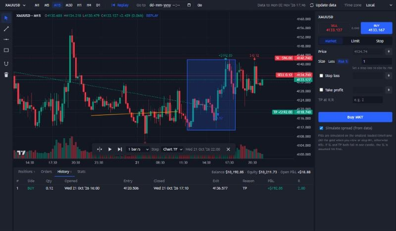

# 👻 Ghost Charts

A free, TradingView-style chart for **manual backtesting** on your own computer.
Pick a date, replay the market candle by candle, draw your levels, and place simulated trades with stop loss and take profit.
Candle data comes from your own **MetaTrader 5** terminal (a free demo account works).



## Features

- TradingView-like candlestick chart: zoom, scroll, crosshair, volume, M1 / M5 / M15 / M30 / H1 / H4 / D1
- Drawing tools: trend line, horizontal line, rectangle, with an OHLC magnet. Drawings stay put when you change timeframe
- **Bar replay**: start from any date or click a candle, then step (→) or play (Space) at up to 25 candles/s.
  Step size can be smaller than the chart timeframe, so you can watch an H1 candle form in M5 steps
- Orders: market, limit, stop; size in lots or % risk; SL/TP by price, by clicking the chart, or by R:R.
  Drag SL/TP/order lines on the chart to modify them
- Realistic fills: simulated on M5 (or M1) candles using the broker's spread; if SL and TP are inside the same candle, SL is assumed first
- Positions, orders, trade history and stats (win rate, profit factor, average R, max drawdown, equity curve), CSV export
- Everything is saved in your browser, so you can close it and continue the session later

---

## Prerequisites

You need **four things**. Steps 1–3 are one-time installs.

| # | What | Why | Cost |
|---|---|---|---|
| 1 | Windows 10 or 11 | MetaTrader's Python connector only works on Windows | — |
| 2 | Python 3.9 or newer | Runs the small local server and downloads the candles | Free |
| 3 | MetaTrader 5 + a broker account | Source of the candle data. A **demo** account is enough | Free |
| 4 | Internet connection | Downloading candles; the chart library loads from a CDN | — |

### 1. Install Python

1. Download Python from <https://www.python.org/downloads/> (the big yellow button).
2. Run the installer. **On the first screen, tick "Add python.exe to PATH"**, then click *Install Now*.
   (If you miss this, Windows won't find `python`. Re-run the installer, choose *Modify*, and tick it.)
3. Check it works: press `Win + R`, type `cmd`, press Enter, and run:
   ```
   python --version
   ```
   You should see something like `Python 3.12.4`.

### 2. Install MetaTrader 5 and open a demo account

1. Download MetaTrader 5 from <https://www.metatrader5.com/en/download>, or from your broker's website
   (Exness, IC Markets, Pepperstone, etc. all offer it).
2. Open MetaTrader 5. If it asks, create a **demo account** (*File → Open an Account*). No money or ID needed.
3. Make sure it is **logged in**: the bottom-right corner should show a connection speed, not "No connection".
4. Recommended — allow more history: *Tools → Options → Charts → Max bars in chart* → **Unlimited**, then restart MetaTrader.
   Otherwise brokers may only return the most recent ~100,000 candles.

> MetaTrader 5 must be the **desktop app** on the same computer. The web or phone app won't work.

### 3. Get Ghost Charts

**Option A — download ZIP (easiest):** on the GitHub page click the green **Code** button → **Download ZIP**,
then right-click the ZIP → *Extract All*.

**Option B — with Git:**
```
git clone https://github.com/GhostInTheWeights/GhostCharts.git
```

### 4. Install the Python packages

Open a command prompt **inside the GhostCharts folder** (in File Explorer, click the address bar, type `cmd`, press Enter), then run:
```
pip install -r requirements.txt
```
This installs `MetaTrader5`, `numpy` and `pandas`. You only need to do this once.

---

## Running it

1. Open **MetaTrader 5** and make sure it's logged in.
2. Double-click **`start.bat`** in the GhostCharts folder.
   - A black window called **"Ghost Charts server"** opens. Keep it open while you use the app.
   - Your browser opens <http://localhost:8765>.
3. **First time only:** you'll see a welcome screen. Click **Download data**.
   Full history (including 1-minute gold candles since 2023) takes a few minutes; later updates take seconds.
4. When you're done, close the black server window.

Without `start.bat`: run `python server.py` in the folder and open <http://localhost:8765>.

> Don't open `index.html` by double-clicking it. Browsers block it from loading the data; always use `start.bat`.

## Keeping data up to date

Open MetaTrader 5, then click **Update data** at the top right of the app.
Only new candles are fetched. "Data to …" next to the button shows your newest candle.

## Choosing symbols

Edit `symbols.json` with Notepad:

```json
{ "name": "XAUUSD", "start": "2023-01-01", "m1": true }
```

- `name` — the symbol. Broker suffixes (e.g. `XAUUSDm`, `EURUSD.raw`) are found automatically; set `"mt5_name"` if not.
- `start` — first date to download. How far back you get depends on your broker's history.
- `m1` — also download 1-minute candles (large; enables the M1 timeframe and more precise fills).

Save the file, then click **Update data**. Contract size and price decimals come from MetaTrader automatically.

---

## How to backtest

1. Pick a symbol and timeframe at the top.
2. Click **Replay**, then click the candle where you want to start (or type a date and press *Start*).
3. Press **→** to reveal the next candle, or **Space** to play. Change speed and step size in the replay bar.
4. Draw your zones and lines with the tools on the left.
5. Place trades in the panel on the right. Use the ⌖ buttons to click a price on the chart for entry / SL / TP.
6. Review results in **History** and **Stats** at the bottom. *Export trades CSV* saves them for Excel.

### Keyboard shortcuts

| Key | Action |
|---|---|
| → | Step forward one candle (replay) |
| Space | Play / pause (replay) |
| Alt+T / Alt+H / Alt+R | Trend line / horizontal line / rectangle |
| Del | Delete selected drawing |
| Esc | Cancel / back to cursor |

## Troubleshooting

| Problem | Fix |
|---|---|
| `'python' is not recognized` | Python isn't on PATH. Re-run the Python installer → *Modify* → tick "Add Python to environment variables". |
| `The MetaTrader5 Python package is missing` | Run `pip install -r requirements.txt` in the GhostCharts folder. |
| `Could not connect to MetaTrader 5` | Open the MetaTrader 5 desktop app and log in, then click Update data again. |
| `XAUUSD: not offered by this broker` | Your broker names it differently. Find the name in MT5's *Market Watch* and add `"mt5_name": "..."` in `symbols.json`. |
| History starts later than expected | Set *Max bars in chart* to Unlimited (see Prerequisites step 2) and run Update data again. |
| M1 data looks short after the first download | MT5 was still syncing. Click Update data once more. |
| Blank page / chart doesn't load | Check your internet connection (the chart library loads online), and use `start.bat`, not `index.html`. |
| Port 8765 already in use | Another Ghost Charts window is already running. Close it, or use that one. |

## How it works

| File | Purpose |
|---|---|
| `index.html`, `style.css` | Page layout and styling |
| `app.js` | Chart, drawings, replay, order simulation, stats |
| `server.py` | Tiny local web server (127.0.0.1 only); runs the updater when you click *Update data* |
| `update_data.py` | Downloads candles from MetaTrader 5 into `data/` (M5, optional M1; other timeframes are built from M5) |
| `symbols.json` | Which symbols to download |
| `start.bat` / `update_data.bat` | Double-click shortcuts |

The data files are plain binary arrays (time + OHLC + volume + spread per candle) that the browser loads directly.
Your candle data, drawings and trades stay on your computer; nothing is uploaded anywhere.

## Disclaimer

This is a practice and research tool, not financial advice. Simulated results ignore commissions, slippage and
liquidity, and past performance does not predict future results.

## Credits

Charts by [TradingView Lightweight Charts](https://github.com/tradingview/lightweight-charts) (Apache-2.0).
Released under the [MIT License](LICENSE).
